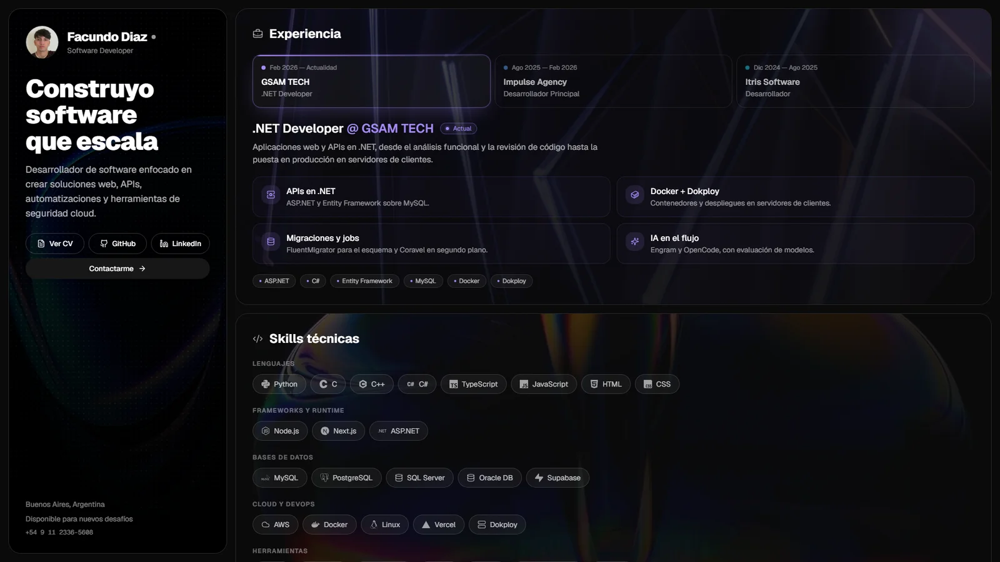

# Facundo Diaz — Portfolio

Portfolio personal: experiencia, skills, formación y proyectos destacados, con descarga del CV y links de contacto.

**🔗 [Ver el sitio](https://<usuario>.github.io/)**



## Stack

- **[Next.js 15](https://nextjs.org/)** (App Router) exportado como sitio estático
- **React 19** y **TypeScript**
- **[Tailwind CSS 4](https://tailwindcss.com/)** y componentes de [shadcn/ui](https://ui.shadcn.com/)
- **[Motion](https://motion.dev/)** para las animaciones de entrada y transiciones
- **[Lucide](https://lucide.dev/)** y **[Simple Icons](https://simpleicons.org/)** para los íconos
- **GitHub Actions** + **GitHub Pages** para el despliegue

## Desarrollo local

Requisitos: **Node.js 18.18+** (probado con 24) y **pnpm**.

```bash
pnpm install
pnpm dev
```

Abrí <http://localhost:3000>.

Para generar la versión de producción:

```bash
pnpm build   # genera el sitio estático en out/
```

Para verla, serví `out/` con cualquier servidor estático, por ejemplo `npx serve out`. `pnpm start` no aplica, porque el sitio no usa servidor de Node.

## Estructura

```
app/
  page.tsx               Página principal: hero, skills, formación y proyectos
  layout.tsx             Metadatos y fuentes
  icon.png               Favicon (foto de perfil)
components/
  experience-section.tsx Experiencia con selector por empresa
  project-card.tsx       Tarjeta de proyecto (banner + detalle)
  site-footer.tsx        Footer
  tech-icon.tsx          Logos de tecnologías en blanco y negro
  section-backdrop.tsx   Imagen de fondo de las secciones
lib/
  site.ts                Datos de contacto, links y rutas del CV y la foto
  image-loader.ts        Agrega el basePath a las imágenes en el export estático
public/
  cv-facundo-diaz.pdf    CV descargable
  images/                Foto, banners de proyectos y fondos
```

## Editar el contenido

| Qué | Dónde |
|---|---|
| Email, teléfono, GitHub, LinkedIn | `lib/site.ts` |
| Experiencia laboral | array `jobs` en `components/experience-section.tsx` |
| Skills | array `skillGroups` en `app/page.tsx` |
| Proyectos | array `projects` en `app/page.tsx` |
| CV | reemplazar `public/cv-facundo-diaz.pdf`, con el mismo nombre |

## Despliegue

El workflow [`.github/workflows/deploy.yml`](.github/workflows/deploy.yml) compila y publica el sitio en GitHub Pages en cada push a `main` o `master`. También se puede ejecutar a mano desde la pestaña **Actions**.

Configuración inicial (una sola vez): **Settings → Pages → Source → GitHub Actions**.

El workflow detecta la ruta del sitio sola:

- en un repo `<usuario>.github.io`, el sitio queda en la raíz;
- en cualquier otro repo, queda en `/<nombre-del-repo>/`.

## Contacto

- 📧 [facundodiaz2727@gmail.com](mailto:facundodiaz2727@gmail.com)
- 💼 [LinkedIn](https://www.linkedin.com/in/facundo-diaz-1a23282b6)
- 🐙 [GitHub](https://github.com/<usuario>)
